# Wbcom Demo Installer

See your theme and plugins working with real-looking content in a few minutes, then remove it all with one click
when you are ready for real members.

Pick what your site is for (a community, courses, events, jobs, a directory, services or a shop). The installer
sets up the free plugins it needs, builds 20 sample people with their posts, courses, events or products, and a
designed home page. Your own users and content are never changed, and nothing is emailed to anyone.

**[Download the latest release](https://github.com/buddynext/wbcom-demo-installer/releases/latest)**

Works with the Reign, BuddyX and BuddyX Pro themes, every Reign add-on, the Wbcom products (BuddyNext, WPMediaVerse,
Jetonomy, Learnomy, Eventonomy, WP Career Board, WB Listora, WP Sell Services, MediaShield, Product Roadmap,
WB Gamification) and BuddyPress, BuddyBoss Platform, PeepSo, WooCommerce, Dokan, WCFM, WC Vendors, LearnDash,
Tutor LMS, LifterLMS, Sensei LMS, WP Job Manager and GeoDirectory.

## What you need

- WordPress 6.5 or newer and PHP 8.1 or newer.
- An administrator account.
- A fresh site is best. The installer works on a site with content too, but asks you to confirm first.

## Install

1. Open the [latest release](https://github.com/buddynext/wbcom-demo-installer/releases/latest) and download
   `wbcom-demo-installer-<version>.zip` under **Assets**.
2. In your dashboard go to **Plugins > Add New > Upload Plugin**, choose the zip, then **Install Now** and
   **Activate**.
3. Go to **Appearance > Set up your site**.

## Set up your demo, step by step

### 1. Site check

The installer reads your theme, your plugins and your own content. Nothing changes on this step. If your Reign
add-ons need a free plugin, it is ticked for you here, or you can let the demo card install it on the next step.

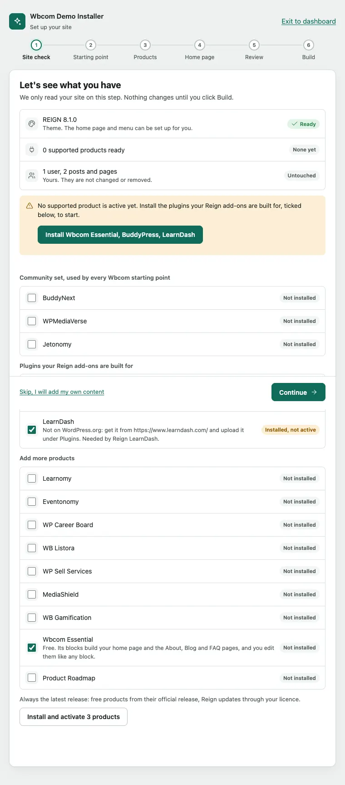

### 2. What is your site for?

One card per purpose. Each shows our product for it, unless your site already has a plugin for that purpose: a
Reign add-on you uploaded comes first, marked **Your add-on**. Everything else is under **See every combination**.

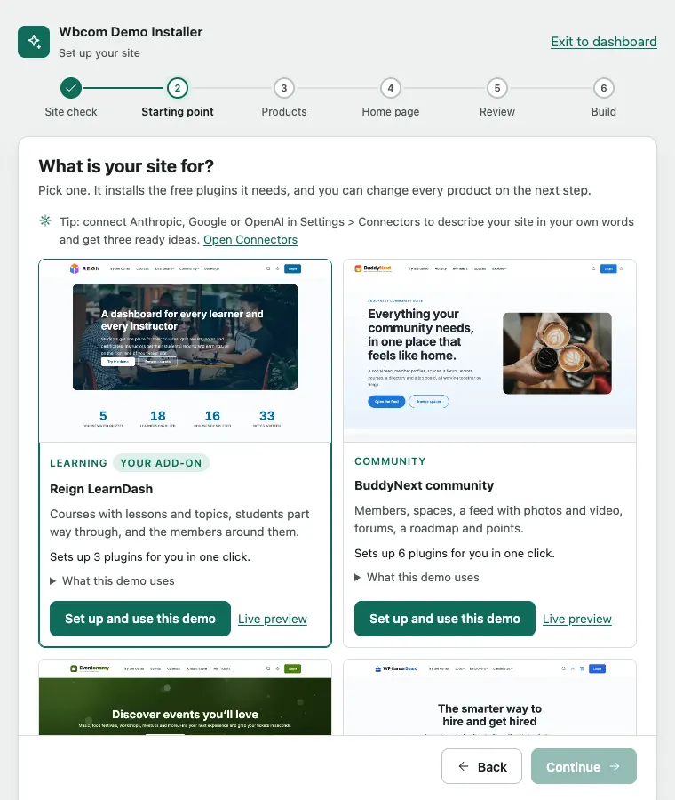

Each card says what it needs. **What this demo uses** opens the full list, and **Live preview** opens the same demo
on our sandbox. Paid plugins you still have to upload show a **Get it** link.

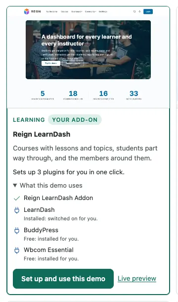

Choose **Set up and use this demo**. It installs, updates or switches on the free plugins in one click, then moves
to the next step.

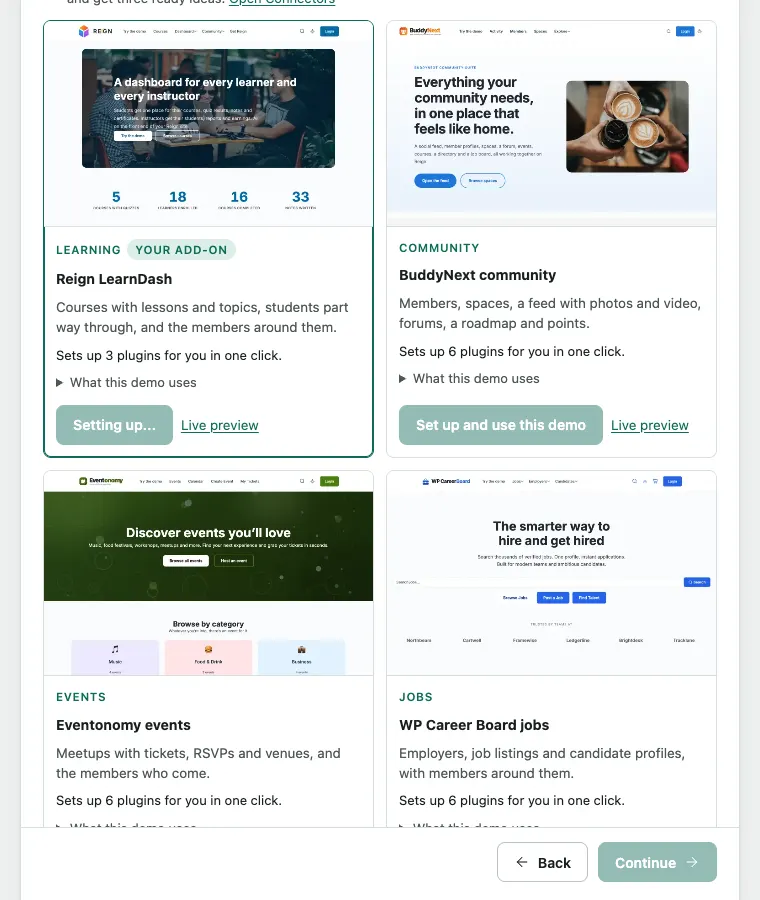

### 3. Products

Every product the demo uses is switched on. Switch any of them off; the bar at the bottom shows what will be created.

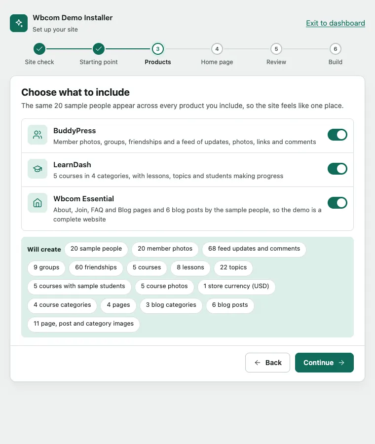

### 4. Home page and menu

Use the demo's designed home page, menu and logo, or keep your own.

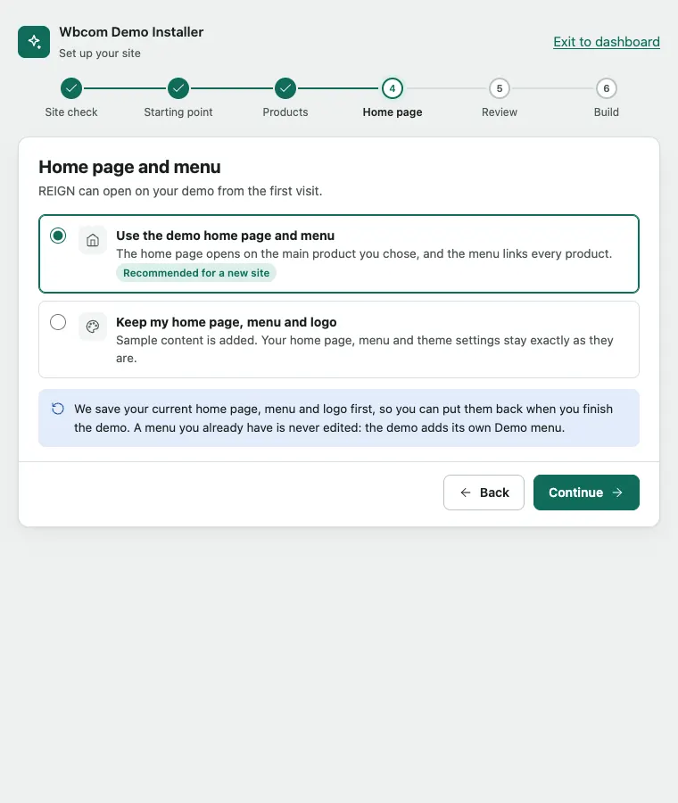

### 5. Review

The exact list of what will be created. You can type your own site name and tagline here. Then choose
**Build my demo**.

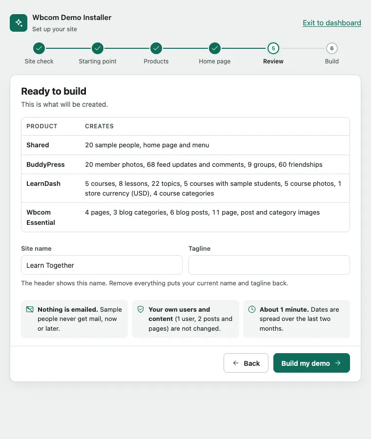

### 6. Build

Takes about a minute. You can leave the page; the build picks up where it stopped when you come back.

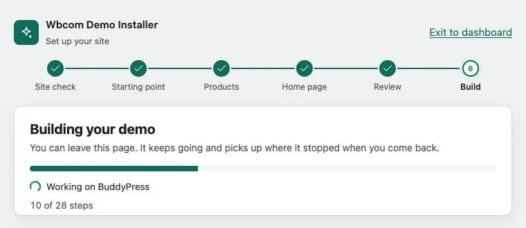

### Your demo is ready

Links to every page, quick ways to make it yours, and what to do when you are done exploring.

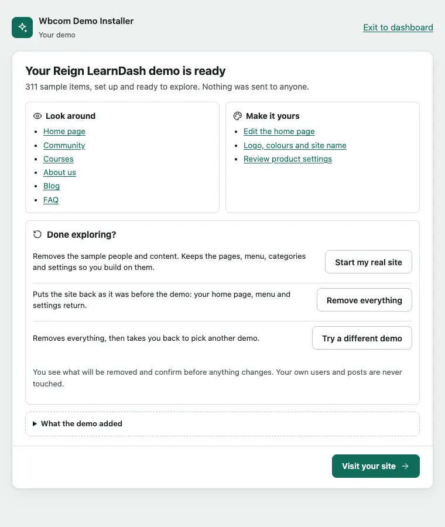

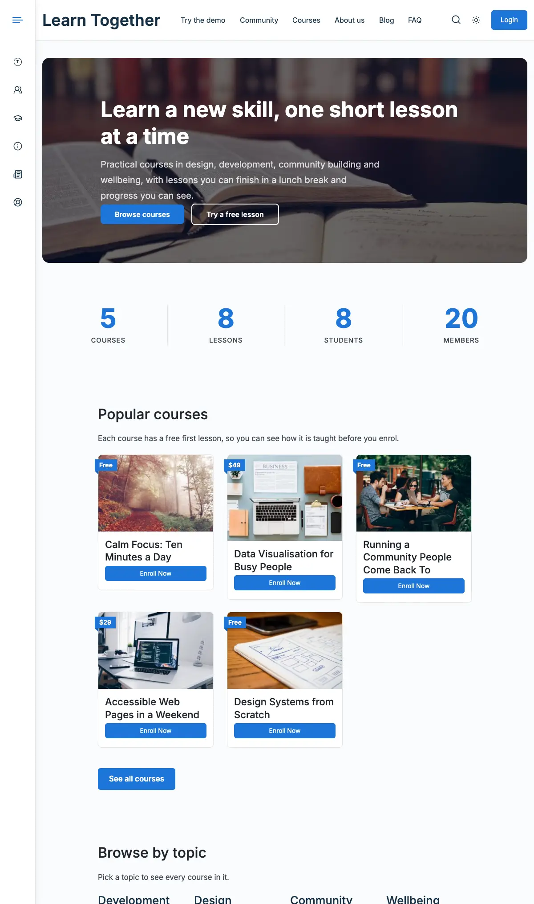

## Remove the demo

Under **Done exploring?** on the last screen (or any time under **Tools > Demo data**):

- **Start my real site**: removes the sample people and content, keeps the pages, menu, categories and settings.
- **Remove everything**: puts your site back as it was, with your own home page, menu and settings.
- **Try a different demo**: removes everything, then takes you back to pick another one.

You see what will stay and what will go before anything changes.

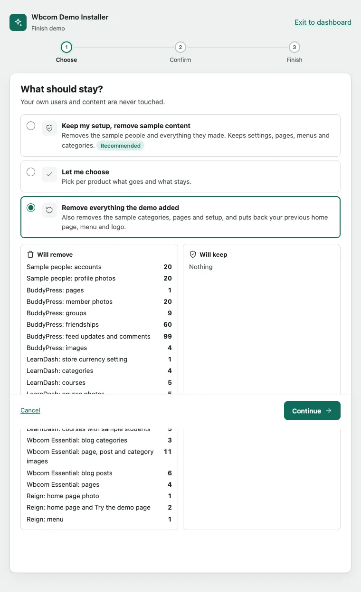

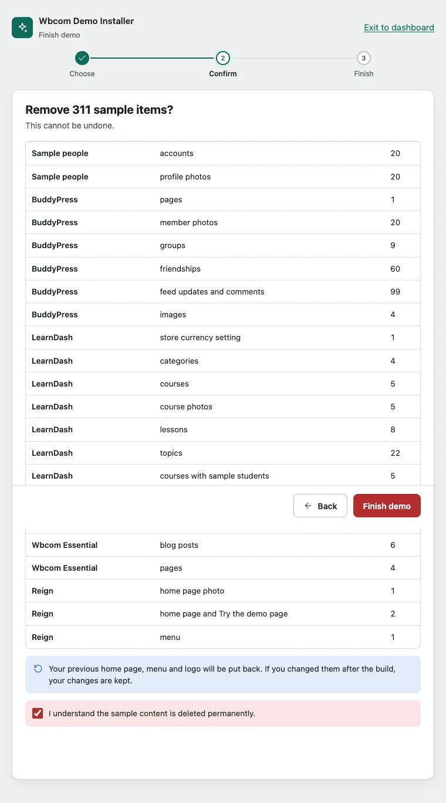

The report checks the site afterwards and tells you nothing from the demo was left behind.

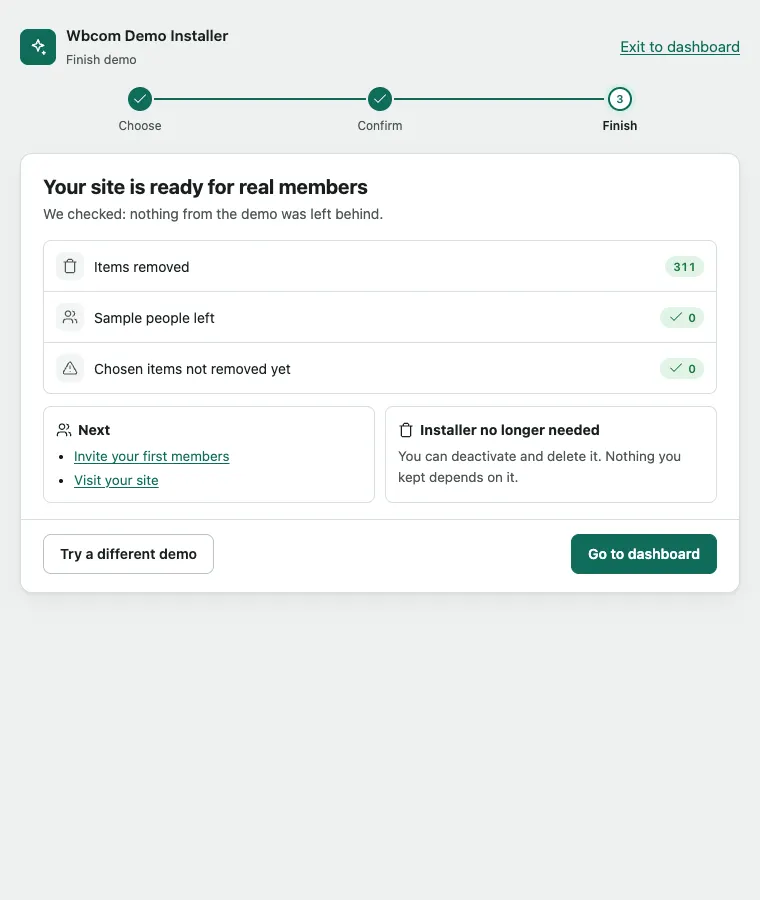

When nothing from the demo is left, you can deactivate and delete the plugin.

## Paid plugins and Reign add-ons

Reign, its add-ons, LearnDash, BuddyBoss Platform, PeepSo and every Pro add-on are paid: you buy, upload and license
them yourself, and the installer never downloads them. Reign add-ons are in your
[Wbcom account](https://wbcomdesigns.com/my-account/?ref=nav). Upload the zip under **Plugins > Add New > Upload
Plugin**, then come back to **Appearance > Set up your site**: the card checks again and sets up the rest.

## More help

- [Import a demo site (Set up your site)](docs/website/getting-started/set-up-your-site.md): every demo, what it needs and what it builds.
- [Remove the demo content (Finish demo)](docs/website/getting-started/finish-demo.md): every way to remove it.
- [Demo problems and fixes (Troubleshooting)](docs/website/troubleshooting/troubleshooting.md) and [FAQ](docs/website/faq/faq.md).
- [WP-CLI commands](docs/website/developer-guide/wp-cli.md) and [adding a product](docs/website/developer-guide/providers.md).
- [Release notes](https://github.com/buddynext/wbcom-demo-installer/releases).

## WP-CLI

```
wp wbcom-demo demos
wp wbcom-demo build --demo=reign-learndash --yes
wp wbcom-demo build --recipe=community [--include=buddynext,jetonomy] [--keep-look] [--dry-run]
wp wbcom-demo status
wp wbcom-demo finish [--mode=keep|all] [--dry-run]
wp wbcom-demo install <product> | --all
```

## License

GPL-2.0-or-later.
