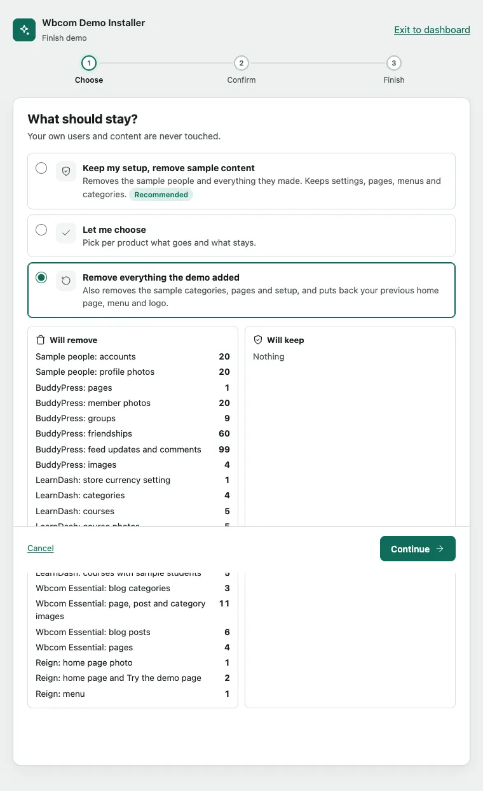
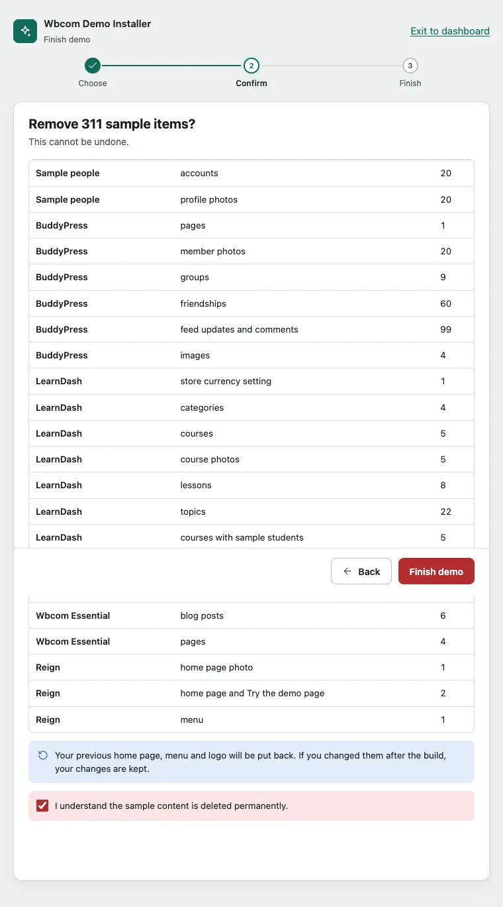
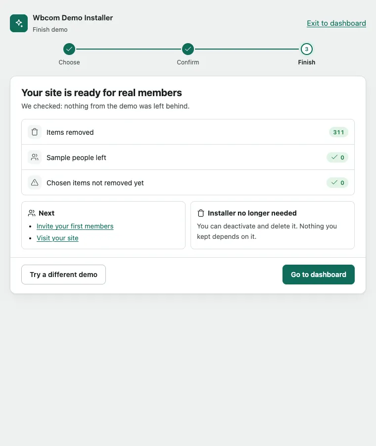

# Remove the demo content (Finish demo)

**Also called:** delete demo data, remove sample content, uninstall demo, reset demo, clean up demo, remove dummy content.

## What this does

When you are ready for real members, this removes the sample content the demo added. You choose what stays. The usual choice keeps everything you set up, such as pages, menus and settings. It removes only the sample people and what they made.

Your own users and content are never removed.

## Before you start

You need a demo built with **Appearance > Set up your site**. See [Import a demo site](set-up-your-site.md).

## Steps

1. Go to **Tools > Demo data**. This screen is there whenever the demo has left anything on the site.

   You can also start from the wizard's last screen, under **Done exploring?** Each choice there opens this screen with that choice already made. **Start my real site** keeps your setup. **Remove everything** removes it all. **Try a different demo** removes it all and lets you pick another demo.

2. Choose what should stay:

   - **Keep my setup, remove sample content** is the usual choice. It removes the sample people and everything they made. It keeps settings, pages, menus, spaces, categories and plans.
   - **Let me choose** lets you tick what to remove for each product.
   - **Remove everything the demo added** also removes sample spaces, categories and plans. It puts back your previous home page, menu and logo.

   

3. Check the **Will remove** and **Will keep** lists, then choose **Continue**.

4. Tick the confirmation and choose **Finish demo**.

   

## You'll know it worked when

The report shows what was removed, what you kept and anything still waiting. It says nothing was left behind only when the demo left nothing on the site.

If you chose **Try a different demo**, the main button is **Pick another demo**. It takes you back to the demo gallery.

## Good to know

### Will my own posts or members be deleted?

No. Your own users and content are never removed.

Sometimes you credit one of the sample people with your own post. That post is never deleted. It is given to you when the sample people are removed.

### Why are some sample people still there?

If you keep some sample content, the sample people who made it stay too.

### A product was switched off. What happens to its content?

Its sample content waits. Activate the product again and choose **Continue removing**.

### Something could not be removed. What now?

The report says what could not be removed. Choose **Continue removing** to try it again. [Demo problems and fixes](../troubleshooting/troubleshooting.md) has more help.

### I changed my menu or logo after the build. Is my version kept?

Yes. If you changed your menu or logo after building the demo, your version is kept.

### How do I end the demo completely?

What you keep stays tracked, so you can remove it later from the same screen. When only settings, pages, menus and categories are left, choose **Keep them as mine**. That ends the demo. After that you can deactivate and delete the plugin.

### Why do some products keep a record after removal?

WPMediaVerse keeps its usage ledger, which is an accounting record. Learnomy keeps an audit log of the removal, which is a security record. Both have the sample people removed. The report names them, and they are not shown on the site.

## For developers

The same removal runs from WP-CLI with `wp wbcom-demo finish`. `wp wbcom-demo verify` shows the last report. See [WP-CLI commands](../developer-guide/wp-cli.md).
