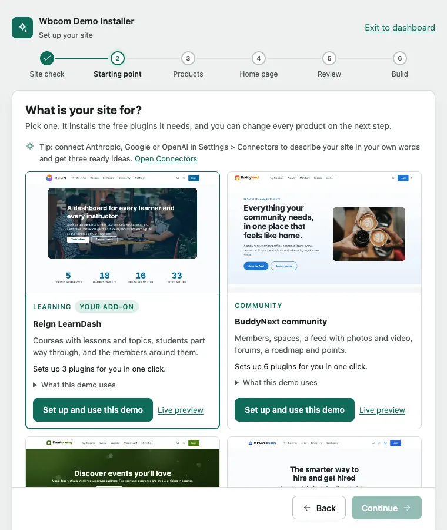
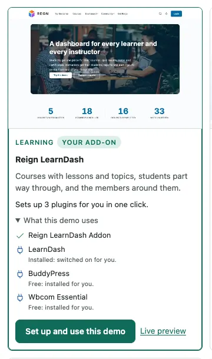

Wbcom Demo Installer fills a fresh site with believable sample content: people, posts, courses, stores, places or
jobs, a designed home page and a menu. You see your theme and plugins working before your first real member joins,
then remove the sample content in one step when you are ready.

## What it is

- **For site owners** who use a Wbcom theme (Reign, BuddyX, BuddyX Pro) or Wbcom plugins and want to see a finished
  site before building their own. No code and no command line: everything happens in one screen in the dashboard.
- **Free.** Download the latest zip from
  [GitHub releases](https://github.com/buddynext/wbcom-demo-installer/releases/latest) (the file named
  `wbcom-demo-installer-<version>.zip`), then upload it under **Plugins > Add New > Upload Plugin**. It is not in your
  Wbcom account downloads.
- **Temporary.** Everything it adds is tracked, and Finish demo removes it again. Your own users, posts and settings
  are never changed.

## Before you start

- Use a fresh site: a new install, a staging copy or a sandbox. The demo is made for showing and trying the
  products, not for a site people already use. If the site already has other members, blog posts or comments,
  the site check says so, and you have to confirm before the build starts.
- Activate your theme (Reign, BuddyX, BuddyX Pro or any other theme).
- Install the paid plugins you bought and activate their licences first: Reign add-ons, LearnDash, BuddyBoss Platform,
  PeepSo, and any Pro add-on. The installer never downloads paid plugins. Free plugins it can install for you.
- **Use one source of sample content.** Some plugins come with their own sample data or importer. Use either that
  or this installer, never both: two sets of sample content mix together and cannot be removed cleanly. If a
  product's own demo data is already on the site, remove it from that product first; the site check tells you.
- You need to be a site administrator.

## Run the wizard

1. Go to **Appearance > Set up your site**.
2. **Site check** shows your theme, the products that are ready, and your own users and posts, which are never changed.
3. **Starting point** asks **What is your site for?** and shows one demo for each purpose: Community, Learning,
   Events, Jobs, Directory, Services and Shop. See [Pick a demo](#pick-a-demo) below for what each one needs.
   - Each card shows our own product for that purpose, unless your site already has a plugin for it. A Reign add-on
     you uploaded puts its demo first, marked **Your add-on**; an active plugin (for example BuddyPress) puts its
     demo in that purpose's place, marked **On your site**.
   - **See every combination** opens the rest: whole-site theme demos, every Reign add-on demo and the starting points
     built from the products you have active.
   Each demo card shows what you still have to upload (with a **Get it** link) and how many free plugins it sets up
   for you. **Set up and use this demo** installs, updates or switches on what is missing and moves you to the next
   step. **Live preview** opens the same demo on our sandbox.

   

   

4. **Products**: switch each product on or off. The bar at the bottom shows exactly what will be created.
5. **Home page and menu**: use the demo home page, menu and logo, or keep your own.
6. **Review** the list. You can type your own site name and tagline here: a new name shows in the header in place of
   the sample logo, and Remove everything puts your current ones back. Then choose **Build my demo**.
7. Wait for the progress bar. You can leave the page; the build continues where it stopped when you come back.

When the build finishes, the wizard names your demo and links to every page. Under **Done exploring?** you choose
what happens next: **Start my real site** removes the sample people and content and keeps the pages, menu and
settings; **Remove everything** puts the site back as it was; **Try a different demo** removes everything and takes
you back to pick another one. Each one shows what will be removed and asks you to confirm first. See
[Finish the demo](finish-demo.md); it is also under **Tools > Demo data** at any time.

## Pick a demo

Every demo adds the 20 sample people, a designed home page and Wbcom Essential's About, Join, FAQ and Blog pages.
"Installed for you" means free plugins the card installs, updates or switches on in one click. "You install" means
paid plugins you buy, upload under **Plugins > Add New** and license yourself.

### What is your site for?

The first cards you see, on any theme. Members come from the community plugin you already run (BuddyPress,
BuddyBoss Platform or PeepSo); on a site without one they come from BuddyNext with WPMediaVerse, Jetonomy and WB
Gamification, all installed for you.

| Purpose | Demo | Installed for you | You install |
|---|---|---|---|
| Community | BuddyNext community | BuddyNext, WPMediaVerse, Jetonomy, Product Roadmap, WB Gamification, Wbcom Essential | |
| Learning | Learnomy courses | Learnomy, MediaShield, the members, Wbcom Essential | |
| Events | Eventonomy events | Eventonomy, the members, Wbcom Essential | |
| Jobs | WP Career Board jobs | WP Career Board, the members, Wbcom Essential | |
| Directory | WB Listora directory | WB Listora, the members, Wbcom Essential | |
| Services | WP Sell Services marketplace | WP Sell Services, the members, Wbcom Essential | |
| Shop | WooCommerce store | WooCommerce, Wbcom Essential | |

When your site already has a plugin for a purpose, that plugin's demo from the tables below takes the card: a Reign
add-on you uploaded (for example the Reign LearnDash Addon puts **Reign LearnDash** under Learning), or an active
plugin such as BuddyPress or Dokan.

### Reign add-on demos

Under **See every combination**, or on top when you uploaded the add-on. Shown when Reign is your active theme. Members come from BuddyPress, or from the community plugin you already run
(BuddyBoss Platform, PeepSo or BuddyNext).

| Demo | You install | Installed for you | Best for |
|---|---|---|---|
| Reign LearnDash | Reign LearnDash Addon, LearnDash | BuddyPress, Wbcom Essential | Course sites on LearnDash |
| Reign Tutor LMS | Reign TutorLMS Addon | Tutor LMS, BuddyPress, Wbcom Essential | Course sites on Tutor LMS |
| Reign LifterLMS | Reign LifterLMS Addon | LifterLMS, BuddyPress, Wbcom Essential | Course sites on LifterLMS |
| Reign Sensei LMS | Reign Sensei Addon | Sensei LMS, BuddyPress, Wbcom Essential | Course sites on Sensei LMS |
| Reign Dokan | Reign Dokan Addon | WooCommerce, Dokan, BuddyPress, Wbcom Essential | Multi-vendor marketplaces |
| Reign WCFM | Reign WCFM Addon | WooCommerce, WCFM Marketplace and Frontend Manager, BuddyPress, Wbcom Essential | Multi-vendor marketplaces |
| Reign WC Vendors | Reign WC Vendors Addon | WooCommerce, WC Vendors, BuddyPress, Wbcom Essential | Vendor shops |
| Reign GeoDirectory | Reign GeoDirectory Addon | GeoDirectory, BuddyPress, Wbcom Essential | Local directories with a map |
| Reign WP Job Manager | Reign WP Job Manager Addon | WP Job Manager, BuddyPress, Wbcom Essential | Job boards |

### Theme demos

Under **See every combination**, shown for the active theme. Wbcom products install as their free versions; add your Pro add-ons yourself if you
have them. Add-ons marked optional make the demo look better but are not needed to build it.

| Demo | You install | Installed for you | Best for |
|---|---|---|---|
| Reign + BuddyPress | Optional: Reign Dokan Addon | BuddyPress, Learnomy, Eventonomy, Jetonomy, WP Career Board, WooCommerce, Dokan, Wbcom Essential | A community that teaches, meets and sells |
| Reign + BuddyBoss | BuddyBoss Platform, LearnDash; optional: Reign LearnDash Addon, Reign WP Job Manager Addon | WP Job Manager, Wbcom Essential | BuddyBoss communities with courses and jobs |
| Reign + PeepSo | PeepSo | Learnomy, Eventonomy, Jetonomy, WP Career Board, Wbcom Essential | PeepSo communities |
| Reign + BuddyNext | | BuddyNext, WPMediaVerse, Jetonomy, Learnomy, Eventonomy, WP Career Board, WB Listora, WP Sell Services, WB Gamification, Wbcom Essential | The full Wbcom suite |
| Reign + BuddyNext + LearnDash + Dokan | LearnDash; optional: Reign LearnDash Addon, Reign Dokan Addon | BuddyNext set, WooCommerce, Dokan, Wbcom Essential | Learning communities with a marketplace |
| Reign + BuddyNext + Tutor LMS + WCFM | Optional: Reign TutorLMS Addon, Reign WCFM Addon | BuddyNext set, Tutor LMS, WooCommerce, WCFM, Wbcom Essential | Learning communities with a marketplace |
| Reign + BuddyNext + LifterLMS + WC Vendors | Optional: Reign LifterLMS Addon, Reign WC Vendors Addon | BuddyNext set, LifterLMS, WooCommerce, WC Vendors, Wbcom Essential | Learning communities with vendor shops |
| Reign Shop | | WooCommerce, Wbcom Essential | A single store |
| BuddyX + BuddyPress | | BuddyPress, Learnomy, Eventonomy, Jetonomy, WP Career Board, WooCommerce, Wbcom Essential | BuddyPress communities on the free BuddyX theme |
| BuddyX + BuddyNext | | BuddyNext set, Learnomy, Wbcom Essential | BuddyNext communities on BuddyX |
| BuddyX Pro + BuddyPress | | BuddyPress, Learnomy, Eventonomy, Jetonomy, WP Career Board, WooCommerce, Dokan, Wbcom Essential | Communities with a marketplace on BuddyX Pro |
| BuddyX Pro + BuddyBoss | BuddyBoss Platform | Learnomy, Eventonomy, Jetonomy, WP Career Board, Wbcom Essential | BuddyBoss communities on BuddyX Pro |
| BuddyX Pro + BuddyNext | | The full Wbcom suite, Wbcom Essential | The full Wbcom suite on BuddyX Pro |

"BuddyNext set" is BuddyNext, WPMediaVerse, Jetonomy, Eventonomy, WB Gamification and WP Career Board.

### Starting points

Under **See every combination**, starting points build from the Wbcom products on your site, on any theme. All of them use the free
versions; the one marked in **Needs** is installed for you when you choose it.

| Starting point | Needs | Also uses | Best for |
|---|---|---|---|
| Community | BuddyNext | WPMediaVerse, Jetonomy, Product Roadmap, WB Gamification, Wbcom Essential | Member communities |
| Learning community | Learnomy | BuddyNext, WPMediaVerse, Jetonomy, MediaShield, WB Gamification, Wbcom Essential | Courses with a community |
| Events community | Eventonomy | BuddyNext, WPMediaVerse, Jetonomy, WB Gamification, Wbcom Essential | Meetups and ticketed events |
| Job board community | WP Career Board | BuddyNext, WPMediaVerse, Jetonomy, WB Gamification, Wbcom Essential | Job boards with candidate profiles |
| Directory | WB Listora | BuddyNext, WPMediaVerse, Jetonomy, WB Gamification, Wbcom Essential | Listings with reviews and maps |
| Services marketplace | WP Sell Services | BuddyNext, WPMediaVerse, Jetonomy, WB Gamification, Wbcom Essential | Freelancers selling services |
| Everything I have | | Every supported product that is active | Seeing all your products together |

## When a paid plugin or Reign add-on is missing

Reign, the Reign add-ons, LearnDash, BuddyBoss Platform, PeepSo and every Pro add-on are paid. You buy, install and
license them yourself; the installer never downloads them.

- **Not installed**: the demo card marks it with **Get it**. Reign add-ons come from your
  [Wbcom account](https://wbcomdesigns.com/my-account/?ref=nav); other paid plugins from their own sellers. Upload the
  zip under **Plugins > Add New > Upload Plugin**, activate its licence, then come back to **Appearance > Set up your
  site**. The card checks again and offers to set up the rest.
- **Installed but not active**: the card switches it on for you when you choose **Set up and use this demo**.
- **An older version**: free plugins are updated to their latest release from the card. Reign and its add-ons are
  updated through your licence, the same way **Dashboard > Updates** does it; without an active licence the card asks
  you to activate it first.
- **A different community plugin is active** (for example BuddyNext on a Reign + BuddyPress demo): the card says so.
  Pick a demo built for the plugin you run.

## Describe your site and let AI build it

This is optional: the wizard works the same without it. With an AI connector set up in **Settings > Connectors**
(Anthropic, Google or OpenAI, with your own key), the **Starting point** step shows "Have a site in mind?" above the
starting points. Choose **Describe my site**, write one or two sentences, for example "a running club with weekend group runs,
training plans and coaches who sell personal plans", and choose **Suggest 3 site ideas**. Each idea shows its name,
tagline, starting point, the products it uses (missing free ones are installed for you) and what the site will have.

Pick one with **Use this idea**: the next steps open with the idea's choices preselected and say what came from the
idea (its starting point, the reason for each product, the name in the header). **Use no idea** on any step returns to
the normal choices. The build writes
the text of the demo for that site, in your site's language: people's bios, spaces, posts, discussions, courses,
events, listings, jobs, services, and the About, Join, FAQ and Blog pages with their blog posts (Wbcom Essential). Photos come from the installer's own library. A product whose text does not pass
the installer's checks uses the sample text instead, so a build never fails because of AI. The requests go through your
connector and are billed to your account; Finish demo removes everything as usual.

Without a connector, administrators see one short tip on the Starting point step with a link to Settings > Connectors;
nothing else changes.

## Pages and blog

With Wbcom Essential active (it can be installed from the site check), the demo also adds About, Join, FAQ and Blog
pages and four blog posts by the sample people, linked from the menu. Keep my setup keeps the pages; the blog posts are
sample content.

The pages are made to fit your theme without any setup:

- **About**: a photo, an introduction, three values in columns, a quote from a member and a "From the blog" carousel.
- **Join**: three steps and a button to the registration page.
- **FAQ**: questions that open and close (the Details block).
- **Blog**: a grid of the blog categories, then the latest posts as cards with photo, category, title, excerpt, date
  and author.

Headings, text, quotes and buttons are standard WordPress blocks, so they take your theme's fonts and colours. The
blog sections are Wbcom Essential's **Post Carousel** and **Category Grid** blocks, which follow the theme's colours.

To edit them, open the page in the block editor:

- Change any text in place, swap the About photo, or add your own blocks.
- **Show your own posts**: the Post Carousel and Category Grid blocks show only the demo's blog categories. Select the
  block and change **Categories** in the block settings (or clear it to show every post), then save.
- **Carousel or grid**: in the Post Carousel block settings, **Display mode** switches between a carousel, a slider and
  a grid, and sets how many posts show.
- Write new posts as usual under **Posts > Add New**; give them a category and a featured image so they look like the
  demo cards.

## What you get

- 20 sample people shared by every product, with profiles and photos.
- Content for each product you chose, dated over the last two months.
- With BuddyPress: member photos, groups, friendships and a feed. If Groups or Friends are switched off in
  BuddyPress, the demo switches them on; Remove everything switches them back.
- With WooCommerce: a store of 13 products in 4 categories, with photos, a few sale prices, stock and reviews from
  the sample people. The shop opens (a new store starts in "coming soon" mode); Remove everything puts that back.
- With LearnDash: 5 courses in 4 categories, each with lessons, topics and a photo, the first lesson open as a free
  preview, and sample students part way through (one finishes each course). Paid courses show in US dollars when
  the site has no currency set yet.
- With Tutor LMS: the same 5 courses, each with topics, lessons, a photo, level and duration, sample instructors,
  and sample students part way through (one finishes each course); the first two students in each course rate it.
  Course ratings and the enrolled count are switched on; Remove everything puts Tutor's settings back.
- With LifterLMS: the same 5 courses, each with sections, lessons, a photo, a free or paid access plan and a free
  preview lesson, sample students part way through (one finishes each course) and two reviews each. If there is no
  course catalog, student dashboard or checkout page yet, the demo adds them, and switches on manual payments so
  paid courses show their price; Remove everything takes both away again.
- With Sensei LMS: the same 5 courses, each with modules, lessons, a photo and a sample teacher, and sample students
  part way through (one finishes each course). With the Reign Sensei add-on, its course reviews are switched on and
  the first two students in each course rate it; Remove everything puts the setting back. If the Reign Sensei add-on
  is installed but waits for Sensei LMS, the site check installs Sensei LMS and switches the add-on on with it.
- With Dokan (and WooCommerce): 4 stores run by the sample vendors, each with a photo, banner, address and phone,
  selling the sample products of their category.
- With WCFM Marketplace (and WooCommerce): the same 4 stores, with a photo, banner, address and phone, selling the
  sample products of their category. If there is no Stores page yet, the demo adds one; Remove everything takes it
  away again.
- With WC Vendors (and WooCommerce): the same 4 stores as vendor shops with an about text, address and phone, selling
  the sample products of their category (shop banners and logos need WC Vendors Pro).
- With WP Job Manager: 8 job listings from 3 companies run by sample people, with logos, job types, salaries and
  remote roles (each company's first job is featured). If there is no Jobs page yet, the demo adds one; Remove
  everything takes it away again.
- With GeoDirectory: 24 places in Philadelphia (GeoDirectory's default city) across 8 categories, run by sample
  people, each with a photo, address and map pin, phone, website and opening hours, and 56 star-rated reviews. The
  place page shows the address, phone, website and hours under the description, and GeoDirectory's location page
  (search, categories, map and the newest places) is offered as the home page. Remove everything takes the categories,
  the phone, website and hours fields and those place page details away again.
- Your home page, menu and logo, if you chose them.
- Each product's own setup finished and its pages shown without sidebars, so there are no setup wizards or
  setup reminders waiting for you.
- No email is sent to anyone.

When you are done looking around, see [Finish the demo](finish-demo.md) or open **Tools > Demo data**.
