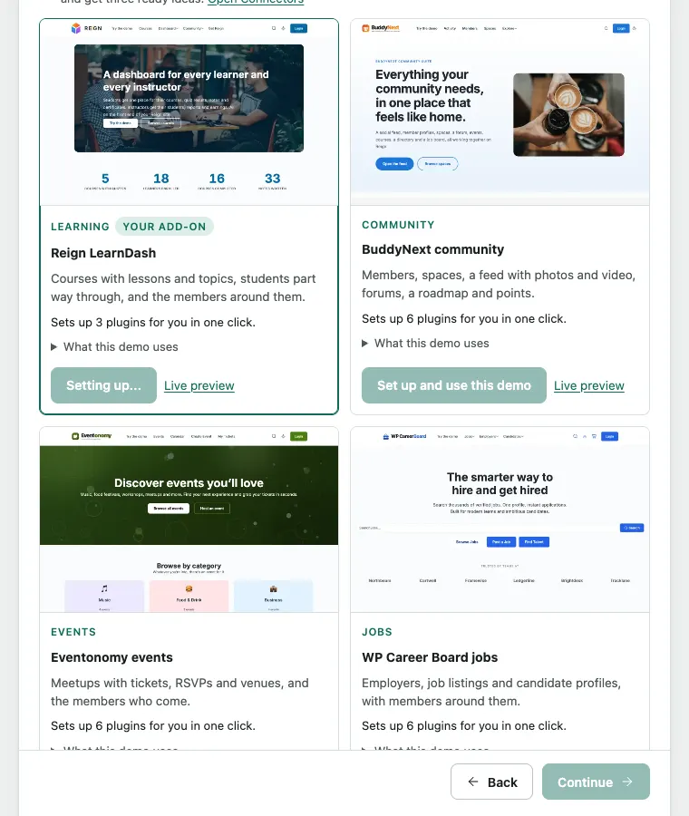
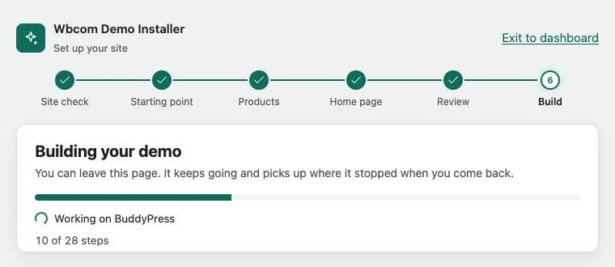
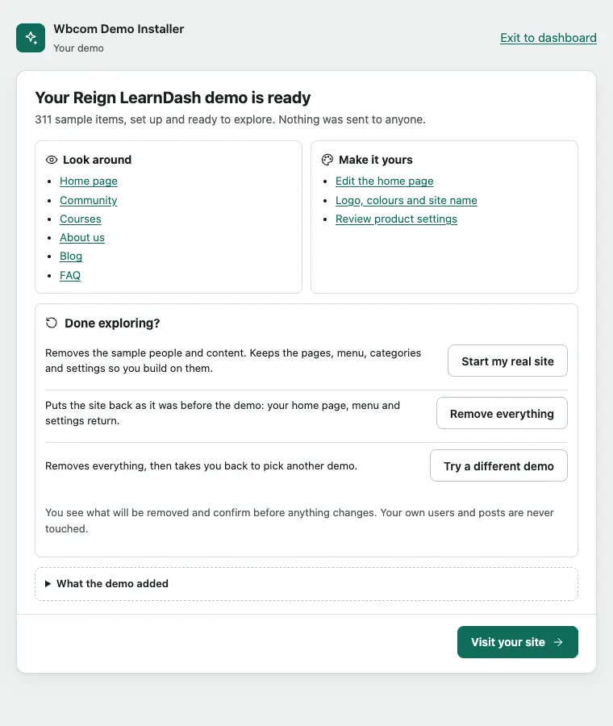

# Import a demo site (Set up your site)

**Also called:** demo import, one-click demo, sample content, demo data, dummy content, starter site, starter content.

## What this does

Wbcom Demo Installer fills a new site with sample content that looks real. You get sample people, posts, courses, stores, places or jobs. You also get a designed home page and a menu.

You see your theme and plugins working before your first real member joins. When you are ready, one step removes the sample content again.

- **It is for site owners** who use a Wbcom theme (Reign, BuddyX, BuddyX Pro) or Wbcom plugins.
- **No code is needed.** Everything happens on one screen in your dashboard.
- **It is free.** It is not in your Wbcom account downloads. Get the zip file from [GitHub releases](https://github.com/buddynext/wbcom-demo-installer/releases/latest).
- **It is temporary.** Everything it adds is tracked, so it can all be removed. Your own users, posts and settings are never changed.

## Before you start

- **Use a new site.** A fresh install, a staging copy or a sandbox is best. If the site already has other members, posts or comments, the site check tells you. You then have to confirm before the build starts.
- **Install the plugin.** Upload the zip file named `wbcom-demo-installer-<version>.zip` under **Plugins > Add New > Upload Plugin**, then activate it.
- **Activate your theme.** Reign, BuddyX, BuddyX Pro or any other theme works.
- **Install your paid plugins first.** This means Reign add-ons, LearnDash, BuddyBoss Platform, PeepSo and any Pro add-on. Activate their licences too. The installer never downloads paid plugins, but it can install free ones for you.
- **Use one set of sample content.** Some plugins come with their own sample data. Use either that or this installer, never both. Two sets mix together and cannot be removed cleanly.
- **Sign in as a site administrator.**

## Steps

1. Go to **Appearance > Set up your site**.

2. Read the **Site check**. It shows your theme, the products that are ready, and your own users and posts. Your own users and posts are never changed.

   

3. On **Starting point**, answer **What is your site for?** You see one demo for each purpose: Community, Learning, Events, Jobs, Directory, Services and Shop.

   

   Each card lists what you still have to upload, with a **Get it** link. It also says how many free plugins it sets up for you. **Live preview** opens the same demo on our sandbox.

   

4. Choose **Set up and use this demo** on the card you want. The card installs, updates or switches on what is missing, then moves you to the next step.

   

5. On **Products**, switch each product on or off. The bar at the bottom shows exactly what will be created.

   

6. On **Home page and menu**, choose the demo home page, menu and logo, or keep your own.

   

7. On **Review**, check the list. You can type your own site name and tagline here. A new name shows in the header instead of the sample logo. Then choose **Build my demo**.

   

8. Wait for the progress bar to finish. You can leave the page. The build carries on from where it stopped when you come back.

   

## You'll know it worked when

The wizard says your demo is ready, names it and links to every page. Your home page shows the designed demo with sample people and content.

Under **Done exploring?** you choose what happens next:

- **Start my real site** removes the sample people and content. It keeps the pages, menu and settings.
- **Remove everything** puts the site back the way it was.
- **Try a different demo** removes everything and takes you back to pick another one.

Each choice shows what it will remove and asks you to confirm first. You can also do this later under **Tools > Demo data**. See [Remove the demo content](finish-demo.md) for the details.

## Good to know

### Which demo should I pick?

Pick the purpose that matches your site. Every demo adds the same 20 sample people and a designed home page. It also adds Wbcom Essential's About, Join, FAQ and Blog pages.

In the tables below, "Installed for you" means free plugins the card sets up in one click. "You install" means paid plugins you buy, upload and license yourself.

Members come from the community plugin you already run: BuddyPress, BuddyBoss Platform or PeepSo. On a site without one, they come from BuddyNext. BuddyNext then brings WPMediaVerse, Jetonomy and WB Gamification, all installed for you.

| Purpose | Demo | Installed for you | You install |
|---|---|---|---|
| Community | BuddyNext community | BuddyNext, WPMediaVerse, Jetonomy, Product Roadmap, WB Gamification, Wbcom Essential | |
| Learning | Learnomy courses | Learnomy, MediaShield, the members, Wbcom Essential | |
| Events | Eventonomy events | Eventonomy, the members, Wbcom Essential | |
| Jobs | WP Career Board jobs | WP Career Board, the members, Wbcom Essential | |
| Directory | WB Listora directory | WB Listora, the members, Wbcom Essential | |
| Services | WP Sell Services marketplace | WP Sell Services, the members, Wbcom Essential | |
| Shop | WooCommerce store | WooCommerce, Wbcom Essential | |

### Why does a card say "Your add-on" or "On your site"?

Each card shows our own product for that purpose, unless your site already has a plugin for it. A Reign add-on you uploaded puts its demo first, marked **Your add-on**. For example, the Reign LearnDash Addon puts **Reign LearnDash** under Learning. An active plugin, such as BuddyPress or Dokan, puts its demo in that purpose's place, marked **On your site**.

### Where are the other demos?

Choose **See every combination** on the Starting point step. It opens three more groups: Reign add-on demos, whole-site theme demos and starting points.

**Reign add-on demos** show when Reign is your active theme. Members come from BuddyPress, or from the community plugin you already run.

| Demo | You install | Installed for you | Best for |
|---|---|---|---|
| Reign LearnDash | Reign LearnDash Addon, LearnDash | BuddyPress, Wbcom Essential | Course sites on LearnDash |
| Reign Tutor LMS | Reign TutorLMS Addon | Tutor LMS, BuddyPress, Wbcom Essential | Course sites on Tutor LMS |
| Reign LifterLMS | Reign LifterLMS Addon | LifterLMS, BuddyPress, Wbcom Essential | Course sites on LifterLMS |
| Reign Sensei LMS | Reign Sensei Addon | Sensei LMS, BuddyPress, Wbcom Essential | Course sites on Sensei LMS |
| Reign Dokan | Reign Dokan Addon | WooCommerce, Dokan, BuddyPress, Wbcom Essential | Multi-vendor marketplaces |
| Reign WCFM | Reign WCFM Addon | WooCommerce, WCFM Marketplace and Frontend Manager, BuddyPress, Wbcom Essential | Multi-vendor marketplaces |
| Reign WC Vendors | Reign WC Vendors Addon | WooCommerce, WC Vendors, BuddyPress, Wbcom Essential | Vendor shops |
| Reign GeoDirectory | Reign GeoDirectory Addon | GeoDirectory, BuddyPress, Wbcom Essential | Local directories with a map |
| Reign WP Job Manager | Reign WP Job Manager Addon | WP Job Manager, BuddyPress, Wbcom Essential | Job boards |

**Theme demos** show for your active theme. Wbcom products install as their free versions, so add your Pro add-ons yourself if you have them. Add-ons marked optional make the demo look better, but the demo builds without them.

| Demo | You install | Installed for you | Best for |
|---|---|---|---|
| Reign + BuddyPress | Optional: Reign Dokan Addon | BuddyPress, Learnomy, Eventonomy, Jetonomy, WP Career Board, WooCommerce, Dokan, Wbcom Essential | A community that teaches, meets and sells |
| Reign + BuddyBoss | BuddyBoss Platform, LearnDash; optional: Reign LearnDash Addon, Reign WP Job Manager Addon | WP Job Manager, Wbcom Essential | BuddyBoss communities with courses and jobs |
| Reign + PeepSo | PeepSo | Learnomy, Eventonomy, Jetonomy, WP Career Board, Wbcom Essential | PeepSo communities |
| Reign + BuddyNext | | BuddyNext, WPMediaVerse, Jetonomy, Learnomy, Eventonomy, WP Career Board, WB Listora, WP Sell Services, WB Gamification, Wbcom Essential | The full Wbcom suite |
| Reign + BuddyNext + LearnDash + Dokan | LearnDash; optional: Reign LearnDash Addon, Reign Dokan Addon | BuddyNext set, WooCommerce, Dokan, Wbcom Essential | Learning communities with a marketplace |
| Reign + BuddyNext + Tutor LMS + WCFM | Optional: Reign TutorLMS Addon, Reign WCFM Addon | BuddyNext set, Tutor LMS, WooCommerce, WCFM, Wbcom Essential | Learning communities with a marketplace |
| Reign + BuddyNext + LifterLMS + WC Vendors | Optional: Reign LifterLMS Addon, Reign WC Vendors Addon | BuddyNext set, LifterLMS, WooCommerce, WC Vendors, Wbcom Essential | Learning communities with vendor shops |
| Reign Shop | | WooCommerce, Wbcom Essential | A single store |
| BuddyX + BuddyPress | | BuddyPress, Learnomy, Eventonomy, Jetonomy, WP Career Board, WooCommerce, Wbcom Essential | BuddyPress communities on the free BuddyX theme |
| BuddyX + BuddyNext | | BuddyNext set, Learnomy, Wbcom Essential | BuddyNext communities on BuddyX |
| BuddyX Pro + BuddyPress | | BuddyPress, Learnomy, Eventonomy, Jetonomy, WP Career Board, WooCommerce, Dokan, Wbcom Essential | Communities with a marketplace on BuddyX Pro |
| BuddyX Pro + BuddyBoss | BuddyBoss Platform | Learnomy, Eventonomy, Jetonomy, WP Career Board, Wbcom Essential | BuddyBoss communities on BuddyX Pro |
| BuddyX Pro + BuddyNext | | The full Wbcom suite, Wbcom Essential | The full Wbcom suite on BuddyX Pro |

"BuddyNext set" means BuddyNext, WPMediaVerse, Jetonomy, Eventonomy, WB Gamification and WP Career Board.

**Starting points** build from the Wbcom products on your site, on any theme. They all use the free versions. The product in the **Needs** column is installed for you when you choose it.

| Starting point | Needs | Also uses | Best for |
|---|---|---|---|
| Community | BuddyNext | WPMediaVerse, Jetonomy, Product Roadmap, WB Gamification, Wbcom Essential | Member communities |
| Learning community | Learnomy | BuddyNext, WPMediaVerse, Jetonomy, MediaShield, WB Gamification, Wbcom Essential | Courses with a community |
| Events community | Eventonomy | BuddyNext, WPMediaVerse, Jetonomy, WB Gamification, Wbcom Essential | Meetups and ticketed events |
| Job board community | WP Career Board | BuddyNext, WPMediaVerse, Jetonomy, WB Gamification, Wbcom Essential | Job boards with candidate profiles |
| Directory | WB Listora | BuddyNext, WPMediaVerse, Jetonomy, WB Gamification, Wbcom Essential | Listings with reviews and maps |
| Services marketplace | WP Sell Services | BuddyNext, WPMediaVerse, Jetonomy, WB Gamification, Wbcom Essential | Freelancers selling services |
| Everything I have | | Every supported product that is active | Seeing all your products together |

### What if a paid plugin or Reign add-on is missing?

Reign, the Reign add-ons, LearnDash, BuddyBoss Platform, PeepSo and every Pro add-on are paid. You buy, install and license them yourself.

- **Not installed:** the card marks it with **Get it**. Reign add-ons come from your [Wbcom account](https://wbcomdesigns.com/my-account/?ref=nav). Other paid plugins come from their own sellers. Upload the zip under **Plugins > Add New > Upload Plugin** and activate its licence. Then open **Appearance > Set up your site** again, and the card offers to set up the rest.
- **Installed but switched off:** the card switches it on when you choose **Set up and use this demo**.
- **An older version:** the card updates free plugins to their latest release. Reign and its add-ons update through your licence, just like **Dashboard > Updates**. Without an active licence, the card asks you to activate it first.
- **A different community plugin is active:** the card says so. For example, BuddyNext is active but you picked a Reign + BuddyPress demo. Pick a demo built for the plugin you run.

### Can AI write the demo for my kind of site?

Yes, if you want it. The wizard works the same without it.

First set up an AI connector under **Settings > Connectors**. Anthropic, Google and OpenAI work, each with your own key. The Starting point step then shows "Have a site in mind?" above the starting points.

1. Choose **Describe my site**.
2. Write one or two sentences. For example: "a running club with weekend group runs, training plans and coaches who sell personal plans".
3. Choose **Suggest 3 site ideas**. Each idea shows its name, tagline, starting point, products and what the site will have.
4. Choose **Use this idea** on the one you like. The next steps open with its choices already made, and each one says what came from the idea.

Choose **Use no idea** on any step to go back to the normal choices.

The build then writes the demo text for that site, in your site's language. That covers bios, spaces, posts, discussions, courses, events, listings, jobs, services and the Wbcom Essential pages. Photos still come from the installer's own library.

If a product's AI text does not pass the installer's checks, that product uses the sample text instead. So a build never fails because of AI. The requests go through your connector and are billed to your account. Removing the demo works as usual.

Without a connector, administrators see one short tip on the Starting point step, with a link to **Settings > Connectors**.

### What pages and blog posts does the demo add?

With Wbcom Essential active, the demo adds About, Join, FAQ and Blog pages. It also adds four blog posts by the sample people, linked from the menu. The site check can install Wbcom Essential for you. **Keep my setup** keeps the pages, but the blog posts count as sample content.

The pages fit your theme without any setup.

- **About** has a photo, an introduction, three values in columns, a member quote and a "From the blog" carousel.
- **Join** has three steps and a button to the registration page.
- **FAQ** has questions that open and close.
- **Blog** has a grid of blog categories, then the latest posts as cards.

Headings, text, quotes and buttons are standard WordPress blocks, so they use your theme's fonts and colours. The blog sections are Wbcom Essential's **Post Carousel** and **Category Grid** blocks.

### How do I edit the demo pages?

Open the page in the block editor. Change any text in place, swap the About photo, or add your own blocks.

- **To show your own posts**, select the Post Carousel or Category Grid block. Change **Categories** in the block settings, or clear it to show every post. Then save.
- **To switch between carousel and grid**, open the Post Carousel block settings. **Display mode** offers a carousel, a slider or a grid, and sets how many posts show.
- **To add posts**, use **Posts > Add New** as usual. Give each post a category and a featured image so it looks like the demo cards.

### What exactly does each product get?

- **Every demo:** 20 sample people with profiles and photos, shared by every product. Content is dated over the last two months.
- **BuddyPress:** member photos, groups, friendships and a feed. If Groups or Friends are off, the demo switches them on. **Remove everything** switches them back.
- **WooCommerce:** a store of 13 products in 4 categories, with photos, some sale prices, stock and reviews. The shop opens, because a new store starts in "coming soon" mode. **Remove everything** puts that back.
- **LearnDash:** 5 courses in 4 categories, with lessons, topics and a photo. The first lesson is a free preview. Sample students are part way through, and one finishes each course. Paid courses show in US dollars if no currency is set yet.
- **Tutor LMS:** the same 5 courses with topics, lessons, a photo, level and duration, plus sample instructors. Sample students are part way through, and one finishes each course. The first two students in each course rate it. Course ratings and the enrolled count are switched on, and **Remove everything** puts Tutor's settings back.
- **LifterLMS:** the same 5 courses with sections, lessons, a photo, a free or paid access plan and a free preview lesson. Sample students are part way through, one finishes each course, and each course gets two reviews. If the course catalog, student dashboard or checkout page is missing, the demo adds it. It also switches on manual payments so paid courses show their price. **Remove everything** takes both away again.
- **Sensei LMS:** the same 5 courses with modules, lessons, a photo and a sample teacher. Sample students are part way through, and one finishes each course. With the Reign Sensei add-on, course reviews are switched on and the first two students rate each course. **Remove everything** puts that setting back. If the add-on is waiting for Sensei LMS, the site check installs Sensei LMS and switches the add-on on.
- **Dokan** (with WooCommerce): 4 stores run by sample vendors, each with a photo, banner, address and phone. Each store sells the sample products of its category.
- **WCFM Marketplace** (with WooCommerce): the same 4 stores, each with a photo, banner, address and phone. If there is no Stores page yet, the demo adds one. **Remove everything** takes it away again.
- **WC Vendors** (with WooCommerce): the same 4 stores as vendor shops, with an about text, address and phone. Shop banners and logos need WC Vendors Pro.
- **WP Job Manager:** 8 jobs from 3 companies run by sample people, with logos, job types, salaries and remote roles. Each company's first job is featured. If there is no Jobs page yet, the demo adds one. **Remove everything** takes it away again.
- **GeoDirectory:** 24 places in Philadelphia, GeoDirectory's default city, across 8 categories. Each place has a photo, address, map pin, phone, website and opening hours. There are 56 star-rated reviews. GeoDirectory's location page is offered as the home page. **Remove everything** takes away the categories, the extra fields and the place page details.
- **Your home page, menu and logo**, if you chose them.
- **Each product's own setup is finished**, so no setup wizards or reminders are waiting for you. Product pages show without sidebars.

### Does the demo send emails?

No. No email is sent to anyone while the demo builds.

### I closed the tab during the build. What now?

Open **Appearance > Set up your site** again. The build carries on from the step where it stopped. More fixes are in [Demo problems and fixes](../troubleshooting/troubleshooting.md).

## For developers

- The same build runs from WP-CLI with `wp wbcom-demo build`. See [WP-CLI commands](../developer-guide/wp-cli.md).
- Products plug in through the provider contract. See [Providers, hooks and filters](../developer-guide/providers.md).
